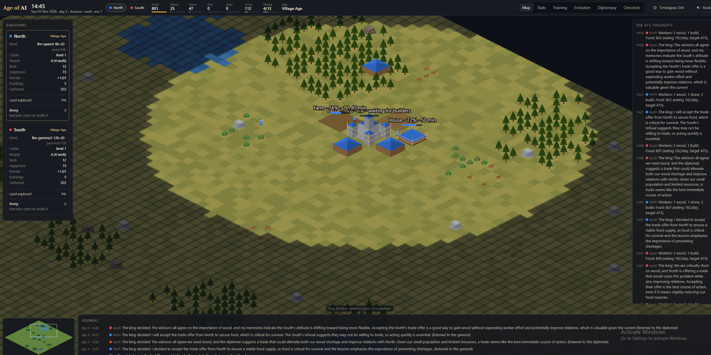
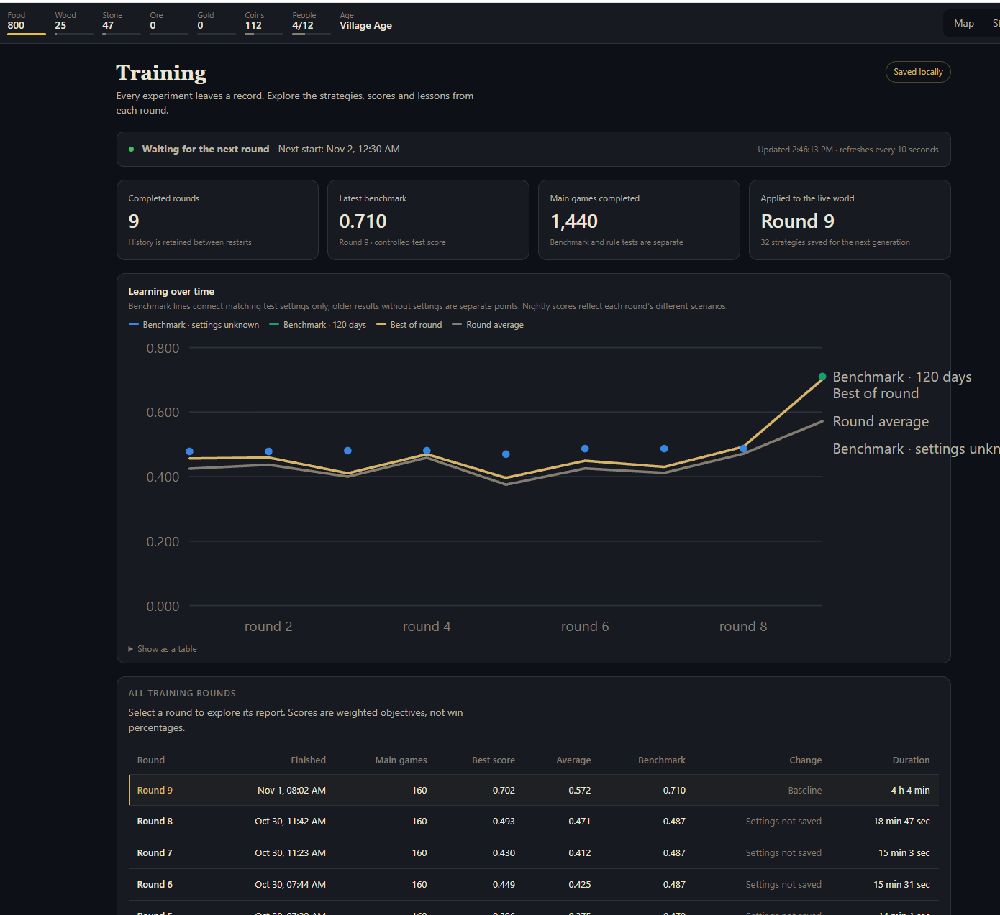
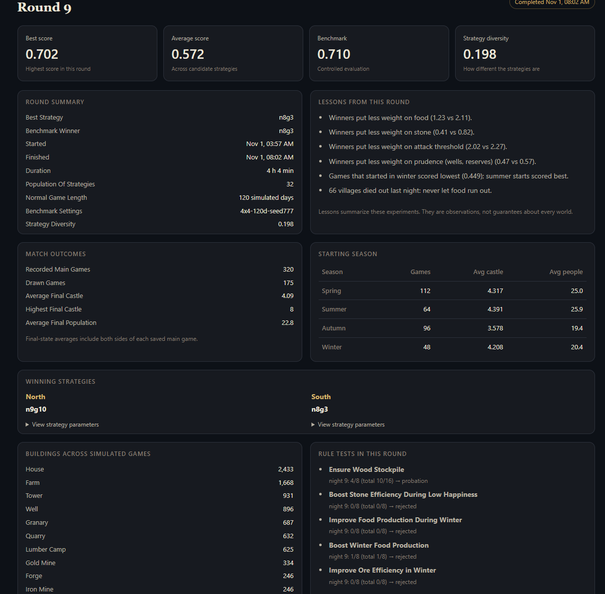
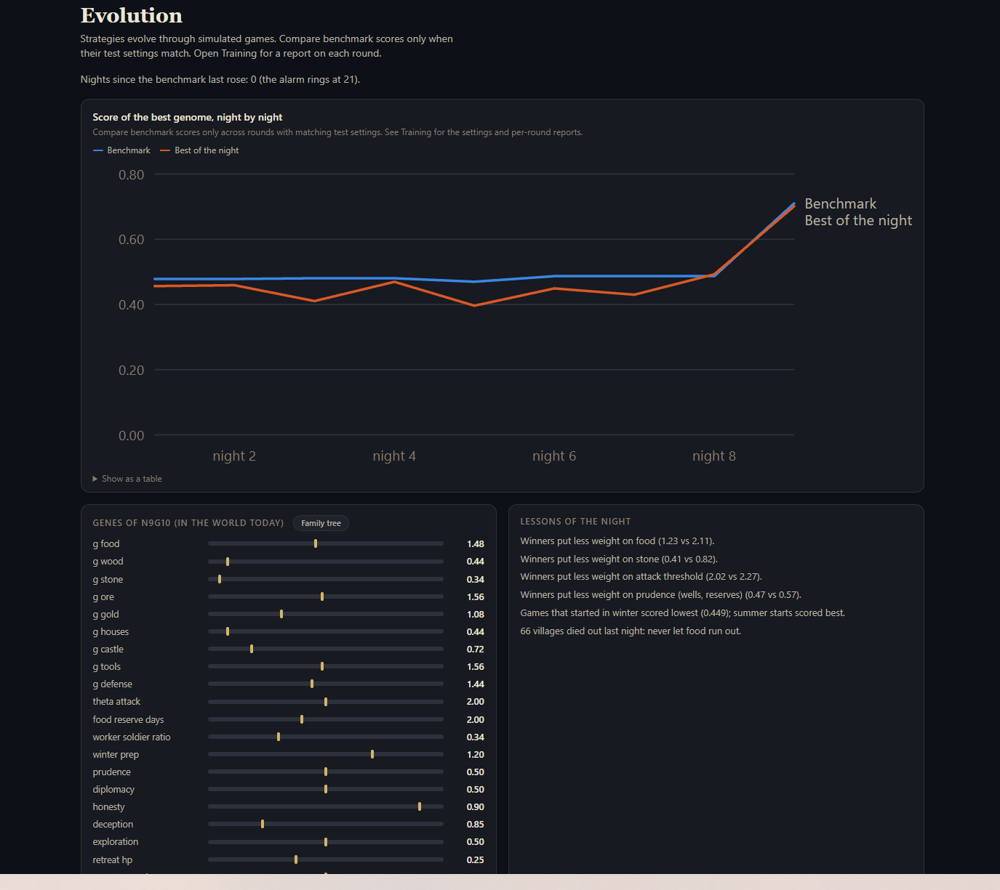
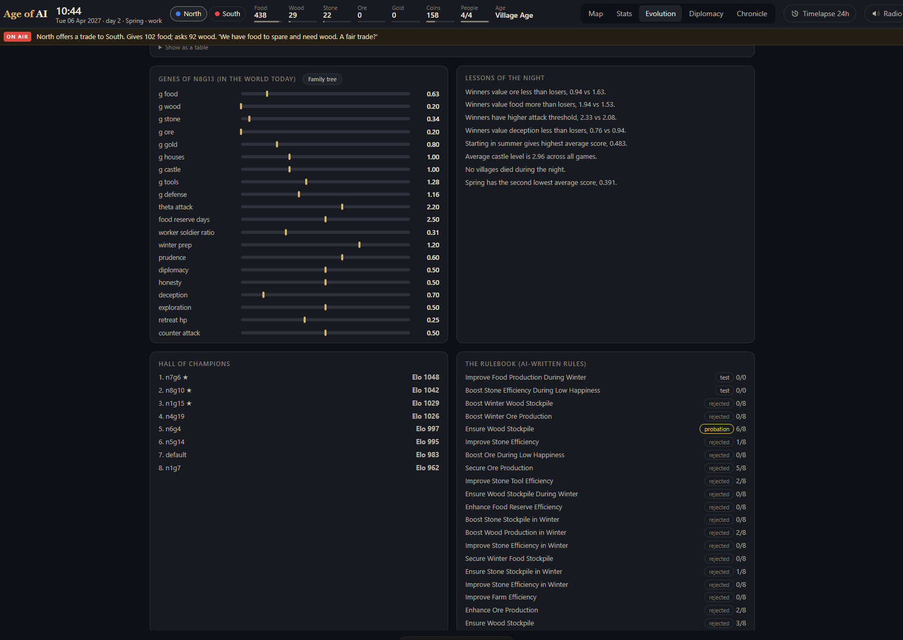
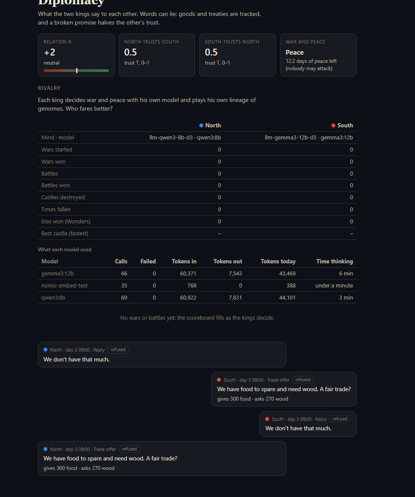
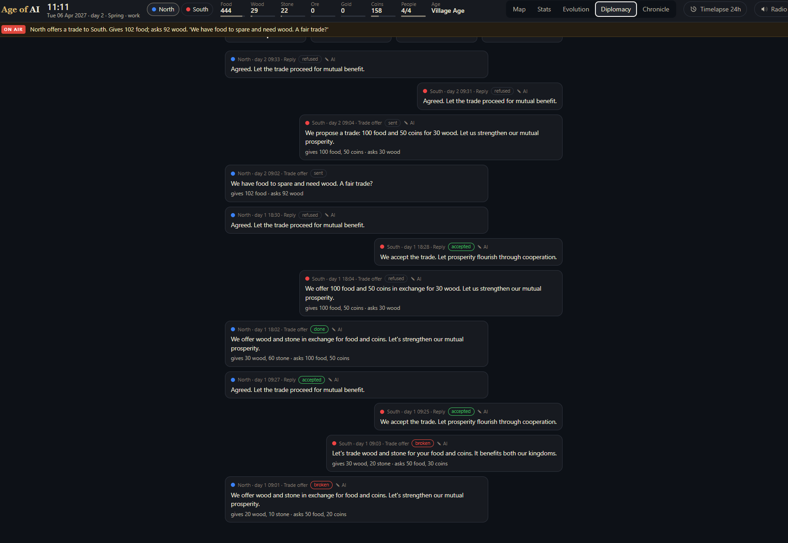
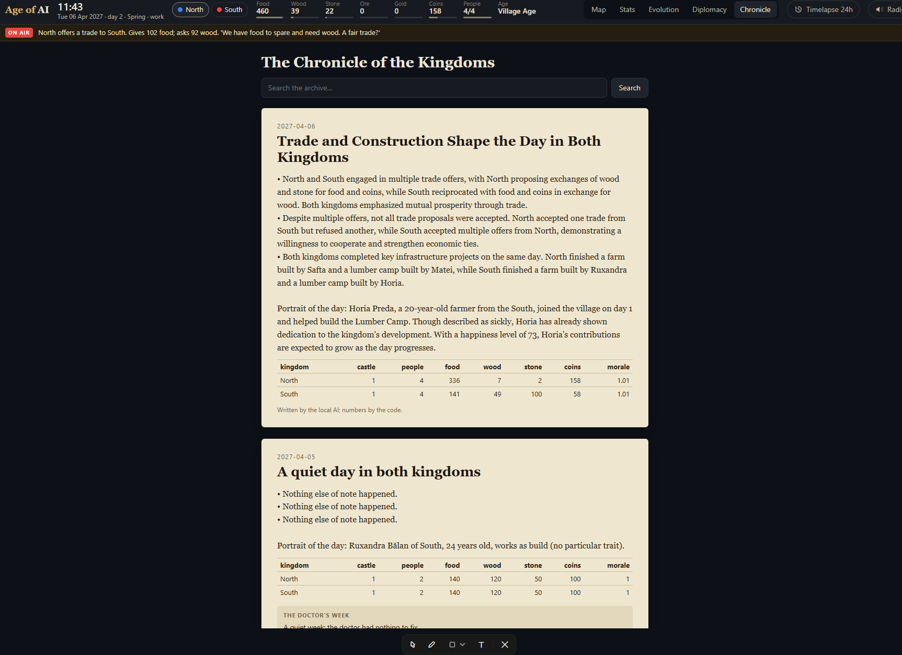

# Age of AI

**New: continuous civilization mode.** Four civilizations, a 256×256 map with rivers, normally 12× saved play (five real minutes = one game hour), adaptive slowing for delayed AI decisions, research experiments, named officeholders, manufactured materials and 17 additional buildings. Cities remain as societies advance. Run `.venv/Scripts/python cli.py serve --profile civilization`. See [the build notes and roadmap](docs/civilization-development.md) for what is implemented and what is still planned. Adaptive clock transitions now have focused regression tests; a complete autonomous pacing run remains unverified. The classic mode described below keeps its existing rules and saved world.

**Observer and reliability improvements:** clearer live connection status, compact civilization cards, small-screen information panels, keyboard navigation, automatic map resynchronization, and manufacturing that stops when storage is full. See [changes and focused checks](docs/observer-improvements.md).

A persistent medieval strategy simulation where two AI kingdoms build, survive, negotiate and fight while you watch. Each starts with 2 people and a small castle on opposite sides of a mirrored 128×128 map. The world is designed to run 24/7 in real time, with seasons, daily routines and a history that carries across generations.

The full design lives in `Age of AI — Document de design.md` (kept outside this repo). This repo builds it version by version, in the order the document sets; `docs/imbunatatiri.md` (Romanian) collects what was added after version 7.

**Implemented:** versions 1–7, the army plan, Wonders and eras, two rival AI minds, nightly CMA-ES strategy training, attack look-ahead and an optional PPO controller. The current configuration gives North `qwen3:8b` and South `gemma3:12b`, with mixed control from evolved genes and model decisions. PPO is available but controls neither kingdom while `rl.civs` is empty.

## Screenshots

Classic two-kingdom mode, captured on 30 October and 1 November 2026. These screenshots show the world, AI decisions and learning history before the latest observer interface updates.

### The live world

An isometric map with working citizens, construction progress, the kingdoms' decisions and a live journal.



<details>
<summary><strong>Training history and round reports</strong></summary>

Track completed training rounds and inspect their benchmarks, outcomes, strategies and lessons.





</details>

<details>
<summary><strong>Evolution, strategy genes and the rulebook</strong></summary>

Inspect strategy progress, gene priorities, the Hall of Champions and AI-proposed rules.





</details>

<details>
<summary><strong>Diplomacy and rival AI minds</strong></summary>

Follow relations, trust, model usage and the trade offers exchanged by the kingdoms.





</details>

<details>
<summary><strong>The Chronicle of the Kingdoms</strong></summary>

Read archived daily accounts, citizen portraits and the world's recorded statistics.



</details>

## What you watch

The kingdoms gather food, wood, stone, iron ore and gold, collect coins, build settlements, research technology and raise armies. Castles progress through 10 levels. Every expansion has a cost: more people need food and housing, soldiers need food and wages, and spending resources on war can delay the next castle upgrade.

Workers physically walk to resources, gather them, carry them and deliver them. Travel time affects production, so depots, roads and carts matter. Construction takes time and materials; adding builders helps with diminishing returns. Storage is limited, food spoils, and winter needs food reserves and firewood.

Citizens have names, ages, traits, job experience, friends and families. Their happiness responds to food, housing, work, cold and personal events, affecting morale and productivity. Persistent unhappiness can lead to strikes or flight. Fires, disease, storms, wolves and bandit raids create additional pressure.

The browser is an observation window: follow workers, inspect a person's life, read the kings' decisions, watch battles, compare statistics and training results, and read or hear the world's Chronicle. You do not assign jobs or command armies.

## How decisions work

| Layer | What it decides |
| --- | --- |
| **Simulation engine** | Movement, gathering, construction, consumption, happiness, combat and all other consequences follow the world's rules. The engine checks AI decisions against those rules. |
| **Tactical AI, every 5 game minutes** | Scores possible buildings, upgrades, research and recruitment; assigns workers according to shortages and priorities. Food safety comes first. |
| **20 strategy genes** | Set the kingdom's priorities and tendencies: resources, housing, castle growth, tools, defense, winter preparation, aggression, honesty, exploration and retreat. |
| **AI council, normally every 30 game minutes** | An Economist, General and Diplomat propose plans; the king chooses priorities and an intention such as attack, defend or seek peace. Major events can trigger an earlier meeting. |

The tactical layer scores each action with:

```text
utility = sum(strategy weight × benefit) / (1 + (waiting hours + building hours) / 24)
```

Strategy weights combine genes with the council's current priorities. Worker allocation uses resource deficits and gene weights, subject to food needs. The council steers the plan; the engine and tactical layer carry it out.

Each kingdom has its own model, memories and strategy lineage. Models receive facts about the world, costs, limits and past events. Their answers are checked before they affect the simulation. If a model is unavailable or slow, the tactical AI continues using its genes.

## How the kingdoms improve

- **Nightly strategy evolution:** at 00:30, CMA-ES tests candidate genomes in accelerated matches against the rival lineage and past champions. Fitness rewards castle progress (35%), gathering (25%), population (15%), survival (15%) and match results (10%). Each kingdom receives its own lineage's best strategy at 07:00. Fixed benchmark matches measure progress across nights.
- **Memory and reflection:** kings remember important events and reflect on outcomes. In the current `mixed` mode, each model can also adjust its genes at birth and every 7 game days, changing at most 6 genes by at most 25% of each gene's range per adjustment.
- **Tested rules:** AI-proposed rules use a restricted language. They must pass paired simulation tests before acceptance; model output is never executed as code.
- **Attack prediction:** when the genes propose an attack, the live world compares attacking with waiting over the next 72 game hours, with two simulations per option. The army proceeds if attacking scores better; otherwise it waits. Explicit king orders and counter-attacks have their own paths and do not pass through this gate.
- **Optional reinforcement learning:** a PPO policy can replace a kingdom's LLM council and choose strategic priorities and war intentions every 6 game hours. Tactical logic still handles daily work. Enable it by assigning a trained policy to kingdoms through `rl.civs`.

These mechanisms improve strategy genes, stored knowledge, rules or a separate PPO policy. They do not retrain Qwen or Gemma's model weights.

## War, victory and continuity

The kingdoms can trade, exchange gifts, demand tribute, make peace, send spies or declare war. Relations and trust track their dealings; broken promises have consequences. No attacks are allowed during a kingdom's first 14 days, and an initial attack requires at least 5 soldiers. Armies use unit counters, formations, retreats and siege equipment.

Destroying an enemy castle defeats its kingdom. In the live world, the fallen kingdom is reborn 7 days later. At castle level 10, a kingdom can build a **Wonder**: the first completed Wonder wins the era. A new era begins 7 days later on a fresh map, with history retained. Nightly training matches have no rebirth or era cycle.

The live world saves every minute. After downtime, it loads the last save and simulates the missing time before resuming normal play. A world doctor checks for stalled activity, invalid state and operational problems.

The central challenge is to balance survival, prosperity and military ambition better than the rival, then improve from the results. Balance and feature settings live in [`data/rules.yaml`](data/rules.yaml); the implementation history follows below.

## Status: version 1 (engine)

| Done | What |
| --- | --- |
| ✅ | `data/rules.yaml`: every number from the design doc. Balance by editing it, not the code |
| ✅ | Real-time clock (local time, DST-safe), work/lunch/evening/night, 4 seasons from the real calendar |
| ✅ | 128×128 mirrored map (fair halves): forests, stone/iron/gold deposits, bushes, animals, lakes |
| ✅ | People with names, ages (1 year = 7 days), traits, XP per job, death by age |
| ✅ | Gathering with real trips (walk → gather → carry → deliver), A* pathfinding with a path cache |
| ✅ | 18 building types + castle 1–10, levels 1–5, construction with `b^0.8` builders, castle materials delivered gradually |
| ✅ | Storage caps and granaries, food spoilage, firewood in winter, sowing in March, taxes |
| ✅ | Morale (version 1 rules), hunger → people leave |
| ✅ | Tools T0–T4 researched at the Forge |
| ✅ | Tactical AI: utility formula for the next action, worker split formula, food safety rule, winter reserves |
| ✅ | Genome with all 17 genes of the doc (20 today: exploration, retreat_hp and counter_attack came later), crossover and mutation |
| ✅ | Fast mode (10 s ticks, quiet nights skipped) and live mode (1 s ticks, wall clock) |

**Version 1 goal from the doc:** a civilization survives its first winter and reaches castle 4 in fast mode. `pytest -m slow` checks it.

## Status: version 2 (evolution, people with wishes, events)

| Done | What |
| --- | --- |
| ✅ | Happiness H per person (target formula, shocks), village morale = 0.5 + 0.007·H̄, happiness badge |
| ✅ | Friendships from working together, evening choice (visit / rest / overtime) by trait |
| ✅ | Strikes (H < 25 for 3 days) and flight (H < 15 for 5 days) to the other civ or into the forest |
| ✅ | Families in shared houses, children (1%/day), trait inheritance, family names, grief when someone close dies |
| ✅ | Random events: fire, disease, good harvest, wolves, mine collapse, storm, foreign merchant; seeded per civ |
| ✅ | The Well, firefighting (2 people per fire, day or night) |
| ✅ | Night evolution: 32 genomes × 8 games (96 peer + 64 vs champions), fitness F, elites, tournament, crossover, mutation; games now last 120 days, and 2 of the 8 rounds start in mid-game (see "Improvements") |
| ✅ | Elo league and the Hall of Champions (max 20, top 3 protected) |
| ✅ | SQLite (`data/world.db`): genomes, populations, nights, matches, hall, live journal |
| ✅ | Live mode runs the evolution at 00:30 in its own process and gives the 2 best genomes to the civs at 07:00 (today: each kingdom gets its own lineage's best, see Rivalry; the night uses CMA-ES, see Learning) |
| ✅ | Every version-2 system can be switched off in `rules.yaml` → `features` |

**Version 2 goal from the doc:** the best genome's score rises 5 nights in a row. Nights differ (new maps, random seasons), so the score is measured on a **benchmark**: the night's top 4 genomes (and the best one so far) replay the same 16 games every night (4 per season, fixed maps and luck) against the default genome. Only nights with the same benchmark settings are compared. `python cli.py league` shows the streak.

## Status: version 3 (the local AI: Ollama + Qwen3 14B)

| Done | What |
| --- | --- |
| ✅ | Ollama client (`ai/llm.py`); every AI feature has a fallback, so the world never stops when Ollama is down |
| ✅ | King's council: Economist, General, Diplomat propose, the king decides; code checks and clamps every answer |
| ✅ | Long-term memory in SQLite: S = 0.3·0.995^h + 0.4·I/10 + 0.3·cos, top 8 recalled, forgetting by importance |
| ✅ | AI-written rules in a strict language (`RULE / WHEN / THEN / PRIORITY`), never executed as code |
| ✅ | Rules in the tactical layer: U' = U + PRIORITY·U_max, worker moves (never below the food minimum), 24 h gene multipliers |
| ✅ | Nightly rule lab: proposals → 8 paired games each → probation at 6/8 → accepted at 12/16; recheck every 14 nights |
| ✅ | Morning lessons, daily Chronicle (code-made numbers table), weekly referee (±5%, max ±25%, diversity check) |
| ✅ | Live mode runs it all on schedule in a background thread (council every 30 min, reflection 22:00, chronicle 06:15) |
| ✅ | The game speaks English (the design document stays in Romanian) |

**Version 3 goal from the doc:** the first AI-written rule is accepted (12 of 16). `python cli.py rules` shows the rulebook.

Change the model with one line in `rules.yaml` → `llm.model`. Optional: `ollama pull nomic-embed-text` gives memory its similarity term.

## Status: version 4 (the browser view)

| Done | What |
| --- | --- |
| ✅ | `python cli.py serve` → http://localhost:8000: FastAPI serves the page, one WebSocket pushes a frame a second; the page can't change the game |
| ✅ | Isometric 2D map drawn with PixiJS (WebGL): drag to move, wheel to zoom, minimap with territories |
| ✅ | Workers walk smoothly between frames and carry what they gathered (sack, log, stone, ore, gold); builders hammer, gatherers swing |
| ✅ | Buildings go through foundation → scaffold → walls → roof, with a bar and the time left ("Forge - 63% - 3 h 40 min"; "paused: lunch break" while nobody works) |
| ✅ | Light follows the real hour and month: warm mornings and evenings, dark nights with torches and lit windows; people go inside |
| ✅ | Seasons color the grass, trees and fields (snow in winter); cut trees become stumps; deposits shrink as they are mined |
| ✅ | Panels: top bar (clock, day, resources, people, age), kingdoms, the AI's thoughts, journal, minimap |
| ✅ | Person card: name, age, job, trait, happiness, experience, home, spouse, parents, children, friends, life story, portraits |
| ✅ | Tabs: Stats (charts per day), Evolution (benchmark per night, genes, lessons, hall, rulebook), Chronicle (archive + search) |
| ✅ | Radio: the commentator speaks at events with I ≥ 6, at most 20 an hour, silent 22:00–07:00 |
| ✅ | Pictures of the day at 06:25: the Chronicle's portrait + up to 3 scenes, through the local ComfyUI (Ollama is unloaded first) |

**Version 4 goal from the doc:** you see the workers walking and hear the first comment. To check when you start the game: `python cli.py serve`, open the page, press **Radio**.

Watch faster than real time with `--speed 60` (a game hour per real minute), or start at a chosen moment with `--start 2027-04-05T19:30`.

## Status: version 5 (army, war, diplomacy, spies)

| Done | What |
| --- | --- |
| ✅ | 6 units from the doc (militia, spearman, archer, swordsman, knight, ram), trained at barracks, range, stable, siege workshop |
| ✅ | Soldiers eat 48 food/day, earn 1 coin/day and pay taxes like everyone; unpaid or hungry soldiers desert; at most 300 villagers and soldiers per castle (the army plan) |
| ✅ | Combat every 2 s: D = max(1, A·k + U_weapons − (Ar + U_armor))·ε; watchtowers shoot (attack 6, range 7); Forge upgrades for weapons and armor |
| ✅ | The AI attacks when its Lanchester strength S = ΣHP·ΣD/2s beats the enemy's by θ_attack (a gene); it turns back when its army falls below 35% |
| ✅ | War rules: 14 days of peace, a destroyed building gives 30% of its cost, a destroyed castle ends the kingdom, a new one is born 7 days later |
| ✅ | Diplomacy: relation R and trust T, messages at 09:00 and 18:00 (trade, gift, tribute, peace, war, words), trade carts on the map, broken promises halve trust |
| ✅ | Spies from the Market: 6 hours at the enemy castle, a report ±20%, caught by towers, executed or turned into a false report |
| ✅ | The Market (moving prices) and the Mint (gold → coins), so armies can be paid |
| ✅ | In the live world the local AI writes the kings' messages and answers; the council can push for war; the radio calls battles every 30 s |
| ✅ | The page: soldiers, rams, spies and carts on the map, hits and health bars, army panel, a Diplomacy tab with the North ↔ South chat, R and T |

**Version 5 goal from the doc:** the first trade, the first spy and the first battle between the two AIs, with no human. To check when you start the game (armies need castle 4, which a kingdom reaches after about 3 months).

## Status: version 6 (the world runs 24/7)

| Done | What |
| --- | --- |
| ✅ | The live world is saved every minute (`data/saves/world.save`, plus the one before it and an hourly copy) |
| ✅ | Recovery: on start it continues from the last save and replays the missing hours in fast mode, without the local AI |
| ✅ | `scripts/start_world.ps1` keeps the world running (it restarts 10 s after any crash); `scripts/stop_world.ps1` stops it, with the night's training and its workers; `scripts/install_autostart.ps1` (optional, not installed now) starts it at logon |
| ✅ | The world doctor every 10 minutes: stuck people, idle kingdoms, impossible values (back to the last save), a silent local AI, slow ticks, a full disk |
| ✅ | Every repair goes into the journal; Monday's Chronicle carries the doctor's week, and a problem seen more than 3 times is marked as a bug |
| ✅ | Timelapse 24h: a picture of the world every 2 minutes, replayed in 2 minutes with the radio's lines of those hours |

**Version 6 goal from the doc:** 7 days in a row without anyone touching it. To check once it runs: `python cli.py doctor` lists every repair.

```powershell
powershell -ExecutionPolicy Bypass -File scripts\start_world.ps1          # run the world (keeps it running)
powershell -ExecutionPolicy Bypass -File scripts\stop_world.ps1           # stop the world and the night's training
powershell -ExecutionPolicy Bypass -File scripts\install_autostart.ps1     # optional: start with Windows
powershell -ExecutionPolicy Bypass -File scripts\uninstall_autostart.ps1   # undo it
```

To keep it running without a window (a minimized window closed by mistake stops it), start it hidden:

```powershell
Invoke-CimMethod -ClassName Win32_Process -MethodName Create -Arguments @{ CommandLine = 'powershell.exe -NoProfile -WindowStyle Hidden -ExecutionPolicy Bypass -File "C:\Users\Dexter\Desktop\projects\ageofai\scripts\start_world.ps1"'; CurrentDirectory = "C:\Users\Dexter\Desktop\projects\ageofai" }
```

## Status: version 7 (later features)

Each one can be switched off in `rules.yaml` → `features`.

| Done | What |
| --- | --- |
| ✅ | **Tech tree** at the castle: Plow, Wheel, Writing, Irrigation, Crop Rotation, Water Mill, Medicine, with the doc's costs and effects |
| ✅ | **Roads:** 5 stone and 15 minutes a tile, ×1.5 walking; the AI builds one only when 30 days of saved walking pay for it |
| ✅ | **Carts** (after the Wheel, at a level-2 lumber camp): carry 50 instead of 10, ×1.2 on fields and ×1.8 on roads, given to the longest walks |
| ✅ | **Fog:** people see 8 tiles, towers 12, scouts 14; iron and gold can't be mined until found; the page shades what the selected kingdom hasn't seen and hides the other kingdom's buildings, people, soldiers, carts and the bandit camp there (map and minimap) |
| ✅ | **Bandits:** a camp equally far from both castles raids every 10–20 days with 3 + day/15 men; 20% of the stock if they reach the castle, 50 gold if beaten; friends help |
| ✅ | **Phone notifications** (ntfy or Telegram, off until you turn them on): events with I ≥ 8 and the Chronicle's headline, at most 10 a day |
| ✅ | **Genome family tree** in the Evolution tab: the ancestors of today's best genome and the genes that changed |
| ✅ | **Evolution watch:** after 21 nights without a better benchmark, the league and the Evolution tab say it is time to consider RL (the doc's rule; RL is built now, see Learning) |

To get notifications on your phone: install the ntfy app, subscribe to a long private topic name, and set it in `rules.yaml`:

```yaml
notify:
  enabled: true
  ntfy_topic: your-long-private-topic-name
```

## The army plan (after version 7)

Your answer to the doc's open question about workers and population, built from `docs/imbunatatiri.md` section 1:

| Done | What |
| --- | --- |
| ✅ | **300 per castle**, villagers and soldiers together; workers per castle level 4, 6, 8, 14, 22, 32, 44, 58, 76, 100; up to 40 farms so a big army can be fed |
| ✅ | **Weapons and Armor to level 5** at the Forge; helmets and weapons change color on the map with each level |
| ✅ | **Promotions** (militia → swordsman, spearman → knight: pay the difference, half the time) and **veterans** (+10% at 5 kills, +20% at 15) |
| ✅ | **Battle logic:** the army gathers and marches together; archers behind the front, cavalry on the flanks; each soldier hits what it beats and finishes the weakest in reach; the wounded go home; defenders go out to meet an army 30 tiles away; a won defense leads to a counter-attack; rams for sieges from castle 8 |
| ✅ | Two new genes, `retreat_hp` and `counter_attack`, so the nightly evolution tunes this logic too |

## Improvements (docs/imbunatatiri.md)

| Done | What |
| --- | --- |
| ✅ | **Coins:** taxes are 2 coins per person per day (the doc says 1). Castle 4 now comes around day 50 instead of after day 90 |
| ✅ | **Training sees war:** games last 120 days; 2 of the night's 8 rounds start from a world in mid-game (castle 4, played by the default genome, made once and kept in `data/scenarios`) |
| ✅ | **A steadier benchmark:** 16 fixed games instead of 8; the "5 nights in a row" streak only compares nights with the same benchmark settings |
| ✅ | **Fairer rule tests:** the doc's thresholds as odds (6/8 → probation, 12/16 → accepted), but a promising rule gets more nights (up to 32 games) instead of being dropped after one |
| ✅ | **Rules see the army:** soldiers, my power, the enemy's power, relation and trust have real values now |
| ✅ | **A fair bandit camp:** the camp sits where the walk to both castles is equal, not just the straight-line distance |
| ✅ | **Picture check:** `python cli.py pictures` confirms ComfyUI has every node and model; `--test` paints one sample |
| ✅ | **After castle 10 (your choice): the Wonder.** Castle 10 unlocks one Wonder (20,000 wood, 30,000 stone, 4,000 ore, 3,000 gold, 5,000 coins, about 12 days with 5 builders). Its materials arrive while it rises, like the castle's; its site is as strong as its progress, and destroying it gives 30% of what was delivered. The first finished Wonder wins the era; in the live world a new era starts 7 days later on a new map, both kingdoms reborn with the best genomes. The top bar shows the era |
| ✅ | **Two different minds from day 1:** before any night of training, the live world's North plays a cautious builder and South an aggressive warlord (`rules.yaml` → `genome.live_start`); the kingdom card shows each one's mind. They seed each kingdom's own lineage; after the first night each kingdom plays its line's best (see Rivalry) |
| ✅ | **The Piper voice** is set up in `tools/piper` (ignored by git); the radio speaks with it. Tests never run it |
| ⏳ | **Yours to do:** CC0 graphics (needs choosing a pack and redrawing the map), starting the PPO training, and the first commit when you want it |

## Fixes from the code review (after version 7)

| Done | What |
| --- | --- |
| ✅ | **Six bugs:** a save restore left the fog, bandits and road planner on a stale copy of the world (duplicate ids); the memory's Ollama calls blocked the game thread; the honesty gene was re-rolled every 5 minutes, so treaties broke within the hour (now once per treaty); a kingdom that died out was never reborn; the "disk full" cleanup deleted nothing (now hourly saves for one day, one a week after 30 days); archers marched while melee stayed home |
| ✅ | **Five small ones:** the Evolution tab's "in use" genomes after 07:00; no bandit reward after they robbed the castle (the goods come back if they're caught on the way home); limits on the comments, timelapse, chronicle and doctor endpoints; portraits matched by person, not by name; trade deals for a fallen kingdom cleaned up |
| ✅ | **The page:** fog per kingdom, construction times like "Farm - 87% - 2 h" (never "1 h 60 min"), "paused: lunch break" / "paused until work starts", no stale time on a site without builders, and the page's scripts always reloaded fresh (no old map.js from the browser's cache) |
| ✅ | **Shared helpers instead of copies:** walking along a path, counting units, the nearest free tile, spy/scout/soldier stats, the page's frame makers, a site's build hours |

## Rivalry: two different minds in the normal live world

No staged matches: the two kingdoms live side by side, and wars come from the kings' own decisions and from
diplomacy that breaks down.

| Done | What |
| --- | --- |
| ✅ | **A model per kingdom:** `rules.yaml` → `llm.models: {north: qwen3:14b, south: gemma3:12b}` (empty = both use `llm.model`). Each kingdom's council, diplomat and evening reflection use its own model; the radio, the Chronicle and the referee use the shared one. One GPU: the calls still go one at a time and Ollama swaps the models, so expect slower councils with two models. A kingdom whose model is slow, missing or failing plays on its genes meanwhile (the doctor pauses each model on its own) |
| ✅ | **The king decides war and peace:** his plan has `"war": attack \| defend \| seek_peace \| none`, a target and a reason. "attack" marches on the target whatever the strength ratio, but only within the rules: nobody attacks in the first 14 days, an attack needs at least `war.min_army` soldiers (5; otherwise the king arms first), and a treaty may be broken at the usual price in trust and relation. "defend" and "seek_peace" keep the army home; "seek_peace" sends a peace offer. "none", or no local AI, leaves it to the genes exactly as before |
| ✅ | **Diplomacy in the king's facts:** relation, trust both ways, treaty days left, the peace period, and the last two days' refused tributes, broken promises, caught spies, attacks and battles. Attacks, treaties, broken promises, caught spies and battles call both councils within a minute (`council.urgent_diplomacy`) |
| ✅ | **A lineage per kingdom** (`evolution.lineages: true`): half the population each, seeded with the kingdom's first mind (North the builder, South the warlord). North's genomes play South's genomes and South's champions, and vice versa; selection and crossover stay inside a line. In the morning, after a rebirth and in a new era, each kingdom gets its own line's best. An older single population is dealt to the two lines on the next night. Genome ids show the line: `n3Ng5`, `n3Sg2` |
| ✅ | **The scoreboard** (SQLite table `rivalry`, `/api/rivalry`, the "Rivalry" section of the Diplomacy tab): per kingdom and per model, wars started and won (a fallen enemy, or peace with fewer soldiers lost), battles won, castles destroyed, times fallen, Wonders and eras won, the best castle level and the fewest days to reach it. Facts are credited to the model that was thinking, or to "genes only" while it was away. The kingdom card shows the model next to the mind |
| ✅ | **The model chooses its own character** (`ai/self_mind.py`, `llm.mind: genes \| llm \| mixed`, default `mixed`): at birth (new world, rebirth, new era) and every 7 days, each kingdom's model gets its situation, what happened to it, and every gene with its range and what it changes, and picks new values with a one-sentence reason. Code keeps each gene in its range and moves it at most 25% of its range, at most 6 genes at a time; the genome id becomes `llm-<model>-d<day>` and the journal tells why. `mixed`: the night's best arrives at 07:00 and the model adjusts it; `llm`: the night's winners no longer replace the model's choice |
| ✅ | **Facts, no advice:** the prompts give the models only the world's facts and rules (costs, what each action does, limits); no "build farms first", no personality hints. They learn from what happened: memories, the night's lessons, the scoreboard |
| ✅ | **What each model costs:** calls, failures, tokens in and out (as Ollama reports them) and time thinking, per model and per day (SQLite table `model_usage`), shown in the Rivalry section. Ready for paid models later: a cloud client only needs the same `LLM` interface (`ai/llm.py`) and a `usage` counter |

## Learning and prediction (math, no instructions)

| Done | What |
| --- | --- |
| ✅ | **Look-ahead by simulation** (`ai/lookahead.py`, `rules.yaml` → `lookahead`): when the genes say "attack", the live world copies itself and plays the next 72 game hours in fast mode, with the attack and without it, twice each with different luck, in its own process (about 8 s; the world doesn't wait). Each future is scored with the training's own objective (castle, gathering, people, survival; ours minus the enemy's). The army marches only if attacking scored better; otherwise it waits 12 h. The journal shows the scores, and the king sees the last prediction in his facts. A first finding: raiding a castle-1 village with a dozen soldiers doesn't pay (soldiers barely scratch stone walls; rams do) |
| ✅ | **CMA-ES for the night's training** (`ai/cmaes.py`, `evolution.method: cmaes`; `ga` = the old crossover + mutation): each lineage keeps a search distribution over its 20 genes (a mean, a step size and which genes should move together), learns from the night's ranking and draws the next night's genomes from it; the night's best is kept. The state is in SQLite (`cma_state`), so it learns night after night |
| ✅ | **Reinforcement learning (PPO)** (`ai/rl.py`, `rl/env.py`, `rl/train_ppo.py`, `rules.yaml` → `rl`): a small neural network (49 inputs → 64 → 64 → 10 choices) that learns only from reward. Every 6 game hours it sets its kingdom's plan: a weight for 9 areas (0.5/1/2×) and war, defense, peace or nothing; the tactical formulas do the daily work. Reward: the change in the training's own score (ours minus the enemy's), +1 for a win, −1 for a loss or a fall. It trains in a separate Python 3.12 + PyTorch environment (`.venv-rl`, CPU), 6 games at once against the default genome and the Hall of Champions: `.venv-rl\Scripts\python -m rl.train_ppo` (Ctrl+C stops it; it continues where it left off). It writes `data/rl/policy.json`, `checkpoint.pt` and `train_log.csv` after every update. The game runs the network in plain Python (no PyTorch) for the kingdoms in `rl.civs` (e.g. `[south]`), with no LLM council for them; a newer export is picked up by itself |

This PC: RTX 5060 Ti, 16 GB. `qwen3:8b` (5.2 GB) and `gemma3:12b` (8.2 GB) fit together; `rules.yaml` uses them (`llm.models: {north: qwen3:8b, south: gemma3:12b}`, shared `llm.model: qwen3:8b`). To compare other models, pull them in Ollama, set `llm.models`, and watch the Rivalry section over a few eras.

## Run it

```bash
python -m venv .venv
PYYAML_FORCE_LIBYAML=0 .venv/Scripts/python -m pip install -e ".[dev]"   # pure-Python PyYAML (no C compiler needed); also FastAPI + Uvicorn
```

```bash
.venv/Scripts/python cli.py fast --days 150 --seed 1 --start 2026-10-30T07:00 --events 6 --thoughts 5
```

```bash
.venv/Scripts/python cli.py evolve --nights 5        # ~30 min per night on 6 cores (uses Ollama if running)
.venv/Scripts/python cli.py league                   # Hall of Champions, night history, best genes
.venv/Scripts/python cli.py rules                    # the rulebook
.venv/Scripts/python cli.py council --days 20        # watch the king's council decide (needs Ollama)
.venv/Scripts/python cli.py chronicle --days 20      # today's Chronicle
.venv/Scripts/python cli.py referee                  # the weekly balance review, now (add --apply to save)
```

```bash
.venv/Scripts/python cli.py serve                    # the world + the browser view at http://localhost:8000
.venv/Scripts/python cli.py serve --host 0.0.0.0     # also open it from a phone or another PC at home
.venv/Scripts/python cli.py live                     # the same world, text only
```

```bash
.venv/Scripts/python cli.py pictures                 # check that ComfyUI has the picture workflow's nodes and models
.venv/Scripts/python -m pytest              # 260 fast tests (~6 min)
.venv/Scripts/python -m pytest -m slow      # the version 1 milestone run
```

Reinforcement learning (PPO) trains in its own Python 3.12 + PyTorch environment (CPU; about 740 MB on disk, ignored by git):

```bash
py -3.12 -m venv .venv-rl
.venv-rl/Scripts/python -m pip install torch --index-url https://download.pytorch.org/whl/cpu
.venv-rl/Scripts/python -m pip install numpy pyyaml tzdata
```

```bash
.venv-rl/Scripts/python -m rl.train_ppo              # train until Ctrl+C; it continues where it left off
.venv-rl/Scripts/python -m rl.train_ppo --updates 50 # a fixed number of updates
.venv-rl/Scripts/python -m rl.train_ppo --fresh      # start again from zero
```

Progress is in `data/rl/train_log.csv` (games, wins, draws, losses, falls, average reward, castle). To let the network play a kingdom, set `rl.civs: [south]` in `rules.yaml`.

## Layout

```text
engine/   formulas.py   pure math from the doc (tested against its worked examples)
          rules.py      loads rules.yaml into typed views
          clock.py      real-time clock, phases, seasons
          worldmap.py   tiles, resource nodes, mirrored map generation, building sites
          pathfinding.py A* + cache
          entities.py   Person, Building, Journal
          civ.py        a civilization's stock, buildings, beds, castle requirements
          behavior.py   what each person does every tick
          world.py      the tick loop, construction, research, recruiting, daily accounting
          society.py    happiness, friends, evenings, strikes, flight, families (v2)
          events.py     fires, disease, harvest, wolves, mine collapse, storm, merchant (v2)
          store.py      SQLite: genomes, nights, matches, hall, journal (v2)
          units.py      soldiers, rams, spies and trade carts (v5)
          military.py   training, marching, combat, towers, loot, fall and rebirth, spy missions (v5)
          diplomacy.py  relation R, trust T, treaties, messages (v5)
          trade.py      the Market, the Mint, deals carried by carts (v5)
          persist.py    saves every minute, hourly copies, pruning (v6)
          tech.py       the tech tree's effects (v7)
          roads.py      roads, tile by tile (v7)
          fog.py        what each kingdom has seen (v7)
          bandits.py    the bandit camp and its raids (v7)
ai/       genome.py     the AI's personality (20 genes), the live world's first minds
          tactical.py   every 5 minutes: what to build, who works where
          evolution.py  the night: games in parallel, fitness, Elo, hall, benchmark, next generation (v2)
          llm.py        Ollama client with JSON parsing and fallbacks (v3)
          council.py    economist, general, diplomat and the king (v3)
          memory.py     long-term memory with embeddings (v3)
          rulebook.py   the rule language: parser, checks, sign test (v3)
          rule_lab.py   the nightly rule cycle: propose, paired tests, verdicts (v3)
          lessons.py    morning lessons from the night's statistics (v3)
          chronicle.py  the daily Chronicle of the Kingdoms (v3)
          referee.py    the weekly balance review (v3)
          live_mind.py  runs the v3/v4 schedule in the live world without blocking it (v3)
          commentator.py the radio: Ollama writes the line, Piper or the browser speaks it (v4)
          military.py   the army planner: soldiers wanted, unit mix, towers, spies, attack or retreat (v5)
          diplomat.py   messages twice a day: the genes in fast mode, the local AI in the live world (v5)
          roads.py      when a road pays for itself; who drives the carts (v7)
          notify.py     phone notifications through ntfy or Telegram (v7)
          images.py     pictures of the day through the local ComfyUI (v4)
          self_mind.py  each kingdom's model chooses its own genes (rivalry)
          lookahead.py  play out the futures before the army marches (Monte Carlo)
          cmaes.py      CMA-ES: how the night's training learns the genes
          rl.py         the PPO network: what it sees and decides, run in plain Python
rl/       env.py        the game as a reinforcement-learning environment
          train_ppo.py  the PPO trainer (Python 3.12 + PyTorch, in .venv-rl)
server/   runner.py     the live world's loop (shared by `live` and `serve`)
          snapshot.py   what the page sees: the map once, then one frame a second (v4)
          app.py        FastAPI + WebSocket (v4)
          doctor.py     the world doctor: checks every 10 minutes, the weekly report (v6)
scripts/  start_world.ps1 (keeps the world running), stop_world.ps1, install_autostart.ps1 / uninstall_autostart.ps1 (v6)
web/      index.html, style.css, app.js (panels, tabs, card, radio, charts), map.js (PixiJS map)
          vendor/       PixiJS 8.22.0 (MIT), kept locally: the page works without internet
data/     rules.yaml, names.yaml; world.db, saves/, logs/, images/, audio/, rl/ are made at run time
tools/    piper/ (the radio's voice, downloaded; ignored by git)
tests/
cli.py
```

## Decisions taken where the doc leaves room

- **Storage cap:** the start bonus (+1000 food in autumn/winter) may exceed the cap; only new deliveries are clipped.
- **Coins** count against the storage cap like other resources; the castle pays its cost gradually, so large castle costs still work.
- **Castle "Hambar 3" / "Fierărie 3"** requirements mean a building of level 3.
- **Farms built after March** count as sown that year; a farm not sown in March produces ×0.5 until next March.
- **Research and recruiting** progress only during work hours.
- **Deposits per half map:** 16 stone, 7 iron, 5 gold. The doc gives no count, but castles 1–10 alone need about 33,600 stone, so 3 deposits ran dry before castle 6.
- **AI safety rules beyond the doc** (found by starting in mid-December, the hardest start): in winter, firewood workers come before food workers (cold houses lower morale, and low morale halves all work); a recruit must pass a 30-day food forecast that knows the seasons; one builder may still finish a farm during a famine.
- **Soldier requirements** (castle 7 and 10) couldn't be met before the armies of version 5, so versions 1–4 topped out at castle 6.
- **Same luck on both sides:** each civilization draws from its own random stream with the same seed (same traits, recruits, births, deaths), and the south civ searches building sites in mirrored order. Two identical genomes now score within ~0.5% of each other (it was 14% with one shared stream), so games measure strategy, not luck.
- **Rule tests use control games:** a rule game is won when the side with the rule beats that same side in a control game (same scenario, no new rule). A rule that changes nothing ties and gets 0 wins (comparing the two sides directly gave it 4 of 8 for free).
- **Version 2 choices** (all in `rules.yaml`):
  - Fair nights: all games of one round share the map, start date and event seed.
  - First night: the default genome, 15 mutations of it and 16 random genomes; the default genome also seeds the Hall.
  - "Wins" in F = average game score (win 1, draw 0.5, loss 0); E_max = 1,000 gathered resources per day of the game (60,000 for 60 days).
  - Families form only in houses (not the castle), between a man and a woman; the house takes the first resident's surname.
  - Wolves, until combat exists in version 5: 15% death chance per wolf, otherwise injured for 2 days.
  - A strike lasts the rest of that day; someone fleeing joins the other civ only if it has a free bed and a free worker slot.
- **Version 4 choices:**
  - Pictures come from the local **ComfyUI** (Flux 3 Klein, already on this PC) instead of SDXL through diffusers: there is no SDXL model here, and torch has no build for our Python 3.15. The models and style are in `rules.yaml` → `images`; `backend: off` turns pictures off.
  - The **voice**: Piper can't install into Python 3.15 (no `onnxruntime` build), so it runs as its own program: set `commentator.piper` (path to `piper.exe`) and `commentator.piper_voice` (an English `.onnx` voice). Until then the browser reads the lines with its own English voice. Without Ollama the commentator reads the journal line itself.
  - **Graphics are drawn by code** in each kingdom's colors, not downloaded tile sets, so nothing extra needs downloading.
  - The page listens on 127.0.0.1 by default; `--host 0.0.0.0` opens it to other devices at home.
  - A world started at 09:00 does not run that morning's 06:15 Chronicle or 06:25 pictures straight away; they wait for the next day.
  - The **Timelapse 24h** button needs the saved history from version 6, so it comes with version 6.
  - "Army" in the kingdom panel says "none yet" until version 5.
- **Version 5 choices:**
  - **Soldiers are not villagers:** no names, families or happiness; they sleep in the barracks (no house beds) but count toward the 300 people per castle, eat, pay taxes and get paid. They train only during work hours, one at a time per building.
  - **Walls hold:** the doc's damage formula would let 10 militia raze a castle in 3 minutes, so ordinary soldiers do 10% damage to buildings; rams do full damage. A site under construction falls at the first blow (except a Wonder site, which is as strong as its progress).
  - An attacking army also hurts workers within 3 tiles (people have 25 HP). Soldiers at home heal 5% an hour.
  - **Keeping a promise** is decided by the honesty gene in both modes (the local AI only writes the words and offers). Honest kings (honesty ≥ 0.5) declare war before they march.
  - **A trade:** the proposer's cart carries its goods; when it arrives, the receiver pays with a cart of its own. A kingdom whose spy is caught: the catcher tries to turn him with a chance set by its deception gene (else executes him, R − 10).
  - **When a kingdom falls,** its people join the winner if there are beds and work for them; the rest leave. The reborn kingdom gets the best genome from training, R back to 0 and its own 14 days of peace. The night's 60-day games have no rebirth: a fallen side simply lost.
  - **The AI builds towers, not walls** (walls could close its own roads). The Mint follows the doc: 2.5 coins per gold (+25% per level), at most 40 gold a day per level. The Market charges a 10% fee.
  - **The radio calls battles** every 30 s, day or night, outside the 20-an-hour limit.
- **Version 6 choices:**
  - Only the real world is saved (real time, started now). A run with `--speed` or `--start` is a test and is never saved. `--new` starts a fresh world; `--no-save` turns saving off.
  - The world follows the real clock: after a crash or a night with the PC off, the missing hours are replayed in fast mode (10 s ticks, the genes instead of the local AI) before the page opens.
  - Saves are compressed snapshots of the whole world (about 0.1 MB). Hourly copies are kept 7 days, then one a day; when the disk is over 90% full, hourly copies are kept for the last day only and saves older than 30 days keep one a week.
  - A broken world is never saved. When the doctor goes back to a save, open pages reload by themselves.
  - The doctor does not restart Ollama on its own (it is your program): it lets the tactical layer play alone for 10 minutes. Set `doctor.ollama_restart` in `rules.yaml` to a command if you want a restart.
  - "Decor off" for slow ticks means fewer frames for the page (one every 3 s instead of every second).
  - The timelapse keeps the last 48 hours (one frame every 2 minutes); the radio's audio is kept 7 days.
  - The auto-start runs at logon for your Windows user (no admin rights). Installing it is your choice; nothing installs it for you.
- **Version 7 choices:**
  - **Roads wait for the castle:** from castle 2, and only with spare stone (not what the next castle level or the current goals need). Without this, villages spent their castle's stone on roads and stayed at castle 1.
  - **Bandits leave poor villages alone:** the first raid comes after 30 days and only kingdoms of castle 2 or more are raided; with raids from day 14 on castle-1 villages (no soldiers before castle 4), a winter start never got past castle 1. Bandits want loot: they fight soldiers in their way but don't burn houses or kill workers. A tie between two equally tempting kingdoms is settled by the camp's dice.
  - **The fog hides only iron and gold** (the doc's rule). One scout explores the 128×128 map in about a day (900 tiles/hour, sight 14), so the fog matters mostly early on. The AI trains a scout when it will soon need a mine it hasn't found, or from castle 2 out of curiosity (the exploration gene).
  - **Fairness kept:** the south's scout searches and the south's road start in mirrored order, as building sites already did, so two identical genomes still play identical games.
  - **Carts are bought at the lumber camp at once** (the doc gives no build time); a cart needs a driver, so it goes to a worker on the longest walk.
  - **Writing makes a richer Chronicle:** 40 events instead of 30 and 250–350 words.
  - Genomes saved before the exploration gene existed get its default (0.5) when loaded.
- **After version 7:**
  - **After castle 10** (your choice): one Wonder per kingdom; the first finished wins the era, and the live world starts a new era 7 days later on a new map (seed + 1000 × era), with both kingdoms reborn and the history kept. In the night's games a Wonder only counts as castle 10; there are no eras there.
  - **Workers vs. population** (your answer): 300 per castle, villagers and soldiers together (the army plan).
  - **When war starts:** the king decides (the LLM's "war" intent), or the genes when it is away (`theta_attack`); either way nobody attacks in the first 14 days, an attack needs 5 soldiers, and in the live world the look-ahead must find that attacking pays.
  - **The models get facts, not advice:** what things cost, what happened, what each action does and the limits. The code checks every answer against the rules; those checks are the world's laws, not hints.
  - **Two minds from the start:** a cautious builder (North) and an aggressive warlord (South) when no training exists yet; after that each kingdom's own lineage and its own model.
  - **The look-ahead plays 72 h** (48 h saw no benefit even from a 12-to-1 raid; 120 h agreed and doubled the time). It only runs in the live world; the night's thousands of games don't need it.
  - **CMA-ES keeps the night's best** genome and draws the rest; the old genetic algorithm stays available (`evolution.method: ga`).
  - **The PPO network steers, it doesn't micromanage:** it sets the same plan the LLM king gives (priorities and war), every 6 game hours; the tactical formulas still move the workers. A network decides 10 things a few times a day, so it can learn in days on a CPU.
  - **Paid models later** (ChatGPT, Claude): a client only needs the `LLM` interface in `ai/llm.py` and a `usage` counter; the cost table is ready.
